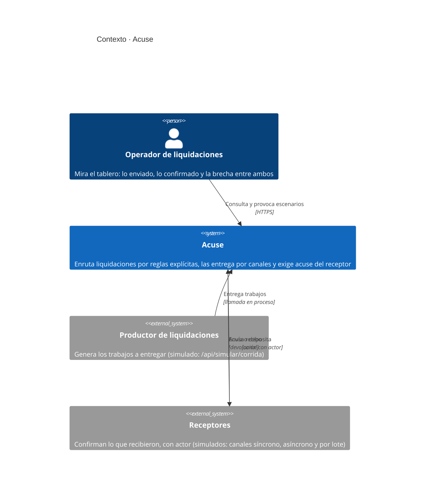
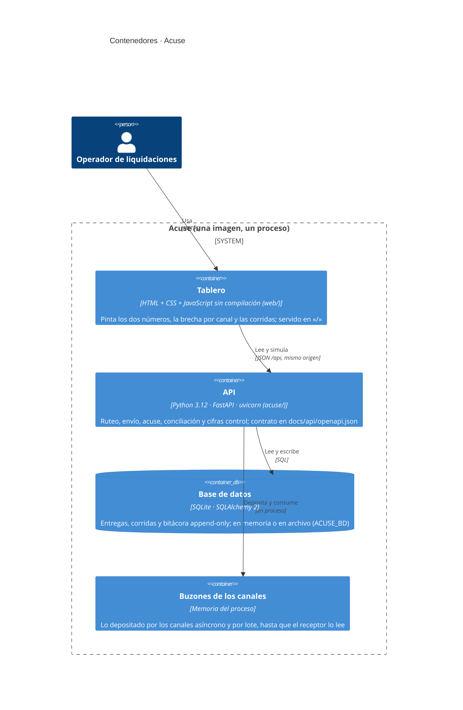
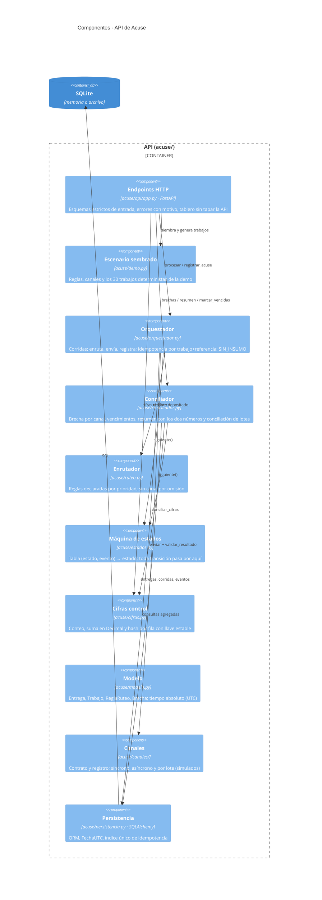
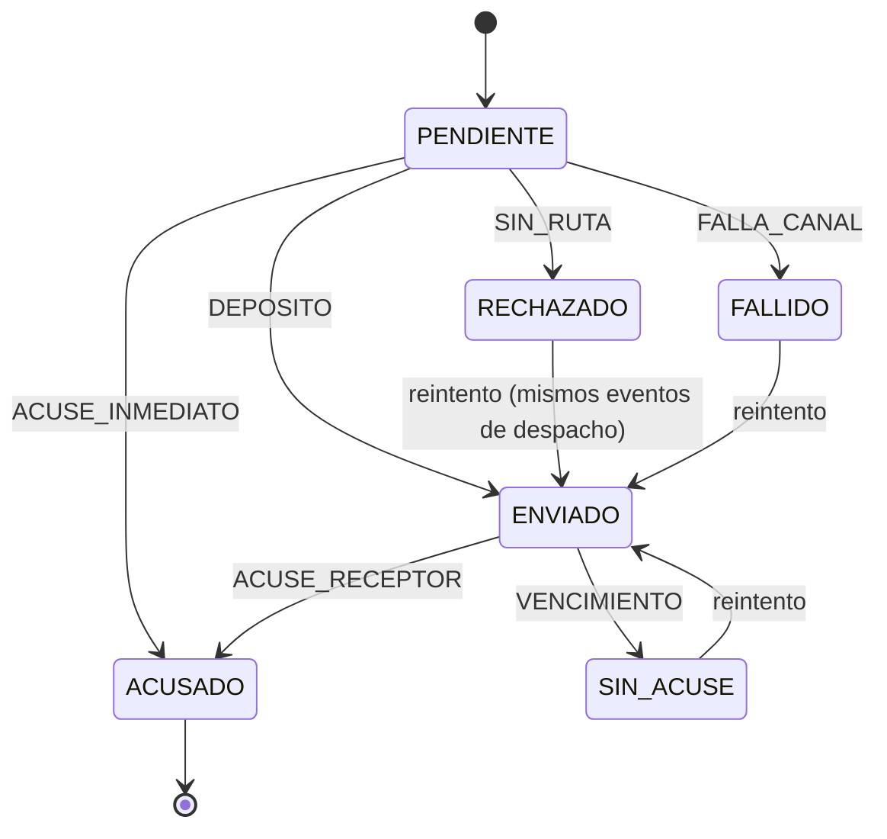

# Arquitectura · Acuse

Modelo C4: contexto → contenedores → componentes. Los diagramas son texto (Mermaid) y se versionan con el código.
Las capas del último nivel no son un dibujo: `tests/test_arquitectura.py` recorre los imports y falla si alguien
las cruza.

## 1. Contexto

Acuse se para entre quien produce liquidaciones y quien debe recibirlas, y sólo da una entrega por hecha cuando el
receptor la confirma. En esta implementación el productor y los receptores están **simulados** (endpoints
`/api/simular/*` y canales en memoria): lo que se demuestra es el protocolo de acuse, no el transporte.

## 2. Contenedores

Un solo proceso y una sola imagen (`Dockerfile`): la API sirve también el tablero, del mismo origen.

## 3. Componentes de la API

## 4. Capas (verificadas por `tests/test_arquitectura.py`)

| Capa | Módulos | Puede importar | Terceros permitidos |
|---|---|---|---|
| dominio | `modelo`, `estados`, `ruteo`, `cifras` | sólo el dominio | ninguno (biblioteca estándar) |
| canales | `canales`, `canales.sincrono`, `canales.asincrono`, `canales.lote` | dominio | ninguno |
| infraestructura | `persistencia` | dominio | SQLAlchemy |
| aplicación | `orquestador`, `conciliador` | dominio, canales, infraestructura | SQLAlchemy |
| composición | `demo` | dominio, canales | ninguno |
| presentación | `api`, `api.app` | todas | FastAPI, Pydantic, Starlette, SQLAlchemy |

Un módulo nuevo sin capa asignada también hace fallar la prueba.

## 5. La entrega como máquina de estados

Tabla completa (18 transiciones válidas y 18 inválidas, todas probadas) en `acuse/estados.py` y
`tests/test_maquina_estados.py`; decisión en [ADR 0004](../adr/0004-maquina-de-estados-por-eventos.md).

## 6. Decisiones

[`docs/adr/`](../adr/): 0001 registrar decisiones · 0002 acuse verificable del receptor · 0003 ruteo explícito ·
0004 máquina de estados por eventos · 0005 cifras control con oráculo independiente · 0006 SQLite como
persistencia.
